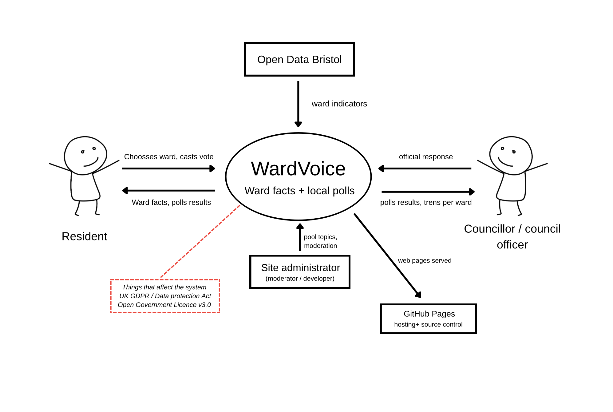

# Project Proposal
Project: WardVoice  – a ward-level information and micro-polling web app for Bristol

Data source: Open Data Bristol – https://opendata.bristol.gov.uk (ward-level datasets, e.g. Quality of Life survey results by ward)

## Business Case

### Problem statement

Bristol residents are asked for their views through large, infrequent exercises such as the annual Quality of Life survey and formal consultations. The results are published as spreadsheets and dashboards that are hard for an ordinary resident to read, and they are rarely tied to a simple, current question such as "What should be fixed first in my ward?"
As a result:
- residents do not know how their ward compares with the rest of Bristol, and have no quick way to say what matters most to them locally;
councillors and council officers see views only in aggregate or after long delays, so it is hard to see which local priorities are shared by many people;
when the council does act, there is no visible link between what residents asked for and what was done.
- The open data already exists. What is missing is a simple, public, ward-by-ward place where residents can see the facts about their ward, vote on local priorities, and see an official response.
  
Idea: helping Bristol residents be heard and helping officials respond faster.

### Business benefits
- Residents: see clear, plain-language facts about their own ward and vote in short polls on local priorities, in under a minute.
- Councillors and officers: see which priorities are shared across a ward, per ward, in one place, without waiting for the next survey cycle.
- Council and city: shows a practical use of the open data the council already publishes; supports transparency because official responses are visible next to the votes.
- Open-data community: a reusable example of turning a raw ward dataset into a public service (similar in spirit to the Bath: Hacked case study, where open data led to a concrete, measurable improvement).
- Low cost to run: a static web app can be hosted free on GitHub Pages, so there is no hosting cost for the prototype.

### Options Considered
Competitor and alternative research (intent / solution / benefits / technology). Details marked "check" should be confirmed in the App Store / websites before submission.
 
| Option | Intent | Solution | Limitation for this problem |
| --- | --- | --- | --- |
| Council's own Quality of Life dashboard and ward profiles | Publish survey results and ward statistics | Dashboards and downloadable data | Read-only; no way to vote or respond; annual |
| FixMyStreet (mySociety) | Report local faults (potholes, lighting) to the council | Map-based problem reporting | Reports individual faults, not shared ward priorities |
| Nextdoor / local Facebook groups | Neighbourhood conversation | Social network | Not official; no data; hard to measure opinion; moderation varies |
| Online petitions | Collect support for one demand | Sign-up page | One issue at a time; no ward facts; no visible official answer per ward |
| **WardVoice (proposed)** | Show ward facts, collect votes on local priorities, show official response | Static web app using Open Data Bristol | Prototype stores votes locally (see risks) |
 
**Pugh matrix** (baseline = the council's existing ward dashboard; S = same (0), + = better (+1), ++ = much better (+2), - = worse (-1); each score is multiplied by the criterion weight):
 
| Criterion | Weight | Ward dashboard (baseline) | Social media group | Petition site | **WardVoice** |
| --- | --- | --- | --- | --- | --- |
| Shows data about my ward | 2 | S | - | - | S |
| Lets residents say what matters locally | 2 | S | + | + | ++ |
| Easy to compare my ward with the city | 1 | S | - | - | + |
| Visible official response | 2 | S | - | + | + |
| Low cost to build and run | 1 | S | + | + | S |
| Results are reliable (representative) | 2 | S | - | - | - |
| **Weighted total** | | **0** | **-4** | **0** | **+5** |
 
Working: social media = -2 + 2 - 1 - 2 + 1 - 2 = -4; petition site = -2 + 2 - 1 + 2 + 1 - 2 = 0; WardVoice = 0 + 4 + 1 + 2 + 0 - 2 = +5.
WardVoice scores "worse" than the council survey on reliability because its votes are self-selected; this is stated openly in the risks below.
 
**Decision:** build WardVoice as a static web app (HTML, CSS, JavaScript) that reads ward data from Open Data Bristol.
### Costs
 
| Item | Estimate |
| --- | --- |
| Hosting (GitHub Pages) | £0 |
| Open data licence (Open Government Licence) | £0 |
| Development time (study time over the module) | Own time; add 25–30% contingency for unexpected work |
| Optional later: real backend / database for votes, postcode lookup | Out of scope for this prototype |

### Expected Risks

| Risk | Likelihood | Impact | Mitigation |
| --- | --- | --- | --- |
| **Votes are not representative.** Self-selected voters are not a statistical sample, so results could mislead. | High | High | Label results clearly as "residents who voted on WardVoice", never as "what the ward thinks"; show the Quality of Life survey (a randomised sample) next to them. |
| **No server on GitHub Pages**, so votes cannot be shared between users in the prototype. | Certain | Medium | Prototype stores votes in the browser and uses sample data; document this as a known limitation and as future work. |
| **Fake or repeated votes** | Medium | Medium | Out of scope for the prototype; future work: one vote per device/account, moderation. |
| **Personal data (UK GDPR)** | Low | High | Collect no names, emails or addresses; ward choice only; no tracking. |
| **Open data changes or goes out of date** (columns renamed, new ward boundaries) | Medium | Medium | Keep a saved copy of the dataset used, record its date and licence; load by ward name from one file so it is easy to update. |
| **Political neutrality** – app could look partisan | Medium | Medium | Neutral wording; poll topics come from a fixed list based on council service areas; no party names. |
| **Time** – scope too big for the assessment | Medium | High | MoSCoW priorities (see requirements.html): build all MUST stories first; drop COULD stories if late. |
| **Accessibility and mobile use** | Medium | Medium | Semantic HTML, sufficient contrast, responsive layout, test in Chrome and on a phone. |
 
---
## Project Scope
**System of interest:** WardVoice – a web app that shows facts about a Bristol ward from Open Data Bristol and lets residents vote in short local polls, with official responses shown next to the results.
 
**In scope** (everything in the context diagram below):
 
- Resident chooses their ward from a list and sees key facts about it (from Open Data Bristol)
- Resident compares their ward with the Bristol average on a few indicators
- Resident votes on local priorities in a short poll (one choice per poll in the prototype)
- Resident and councillor view poll results per ward (list and chart)
- Councillor / council officer views results and posts an official response per ward
- Site administrator adds poll topics and removes inappropriate content
- Data attribution under the Open Government Licence and a short privacy notice
- Hosting on GitHub Pages and version control in GitHub

**Out of scope** (for this assessment):
- User accounts, passwords and verification of residents
- A real server or database; votes are stored in the browser only
- Postcode-to-ward lookup (a ward drop-down is used instead)
- Live integration with council systems, e-mail or push notifications
- Any election or party-political voting
  

