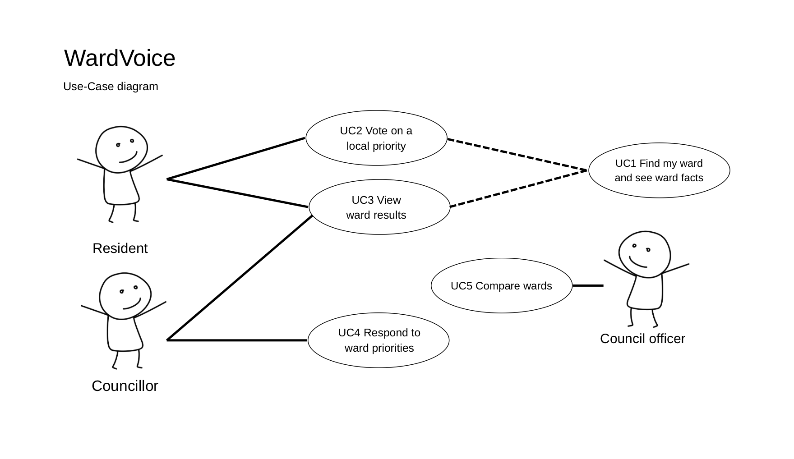

# Requirements

## User Needs

### User stories
- **US1** As a resident, I want to see facts about my ward so that I understand the local context before I have my say.
- **US2** As a resident, I want to vote on local priorities in my ward so that my voice is counted.
- **US3** As a resident, I want to see how my neighbours voted so that I know what my ward cares about most.
- **US4** As a councillor, I want to see my ward's ranked priorities and publish a response so that residents can see I have listened and acted.
- **US5** As a council officer, I want to compare priorities across wards so that I can plan resources fairly.
  
### Actors
| Actor | Description |
|---|---|
| Resident | A person living in a Bristol ward. Uses the app on a phone or laptop. No account needed to view; votes with a postcode check. |
| Councillor | An elected representative for one ward. Logs in to read the ward's results and post official responses. |
| Council officer | A council employee who views city-wide results to plan services. Read-only. |
| Open Data Bristol | External system (opendata.bristol.gov.uk) providing ward boundaries and ward-level facts. |

### Use Cases
*(One use case per team member – assign owners in the last row of each table.)*
 
| **UC1** | **Find my ward and see ward facts** |
|---|---|
| Description | Resident finds out which ward they live in and sees key open-data facts about it. Source: US1. |
| Actors | Resident, Open Data Bristol |
| Assumptions | Pre: resident has internet access. Post: the ward is selected for the session. |
| Steps | 1. Resident opens the app. 2. System asks permission to use location (or resident types a postcode). 3. System queries Open Data Bristol for the matching ward. 4. System shows the ward name, map and key facts. |
| Variations | Permission denied → resident enters postcode manually. Postcode outside Bristol → error message. |
| Non-functional | Ward found in under 3 seconds. |
| Issues | Which Open Data Bristol datasets give the most useful ward facts? |
 
| **UC2** | **Vote on a local priority** |
|---|---|
| Description | Resident votes on which local issue matters most in their ward. Source: US2. |
| Actors | Resident |
| Assumptions | Pre: ward selected (UC1) and a poll is open. Post: one vote recorded. |
| Steps | 1. System shows open priorities for the ward. 2. Resident selects one. 3. Resident confirms. 4. System checks the resident has not already voted in this poll. 5. System records the vote and shows confirmation. |
| Variations | Already voted → system shows the results instead. |
| Non-functional | No name or exact address stored. Mobile-friendly. |
| Issues | How to prevent repeat voting without accounts (postcode + device token?). |
 
| **UC3** | **View ward results** |
|---|---|
| Description | Resident (or anyone) views live results for a ward next to open-data facts and official responses. Source: US3. |
| Actors | Resident, Councillor |
| Assumptions | Pre: ward selected. Post: none. |
| Steps | 1. User opens the Results page. 2. System queries the votes. 3. System shows a ranked chart. 4. System shows the matching open-data fact and any official response for each priority. |
| Variations | No votes yet → "Be the first to vote" message. |
| Non-functional | Results load in under 3 seconds. Accessible chart (text alternative). |
| Issues | Minimum number of votes before showing percentages? |
 
| **UC4** | **Respond to ward priorities** |
|---|---|
| Description | Councillor reads the ranked priorities and publishes an official response. Source: US4. |
| Actors | Councillor |
| Assumptions | Pre: councillor is logged in and assigned to a ward. Post: response is visible to residents. |
| Steps | 1. Councillor logs in. 2. System shows the ward's ranked priorities. 3. Councillor picks a priority. 4. Councillor writes a response and sets a status. 5. System publishes it on the results page. |
| Variations | Councillor edits or withdraws a response. |
| Non-functional | Only the ward's own councillor can respond. |
| Issues | How are councillor accounts verified? |
 
| **UC5** | **Compare wards** |
|---|---|
| Description | Council officer views city-wide priorities to plan resources. Source: US5. |
| Actors | Council officer |
| Assumptions | Pre: officer is logged in. Post: none. |
| Steps | 1. Officer opens the city overview. 2. System queries results for all wards. 3. System shows a map coloured by top priority. 4. Officer selects a ward to drill down. |
| Variations | Officer exports the data as CSV. |
| Non-functional | Aggregated data only – no individual votes visible. |
| Issues | Will officers need their own role, or share the councillor login? |
 
*Use-case diagram:* 
 
---
 

## Software Requirements Specification
### Functional requirements
MoSCoW: **M** Must, **S** Should, **C** Could, **W** Won't (this time).
 
| ID | Requirement | From | MoSCoW |
|---|---|---|---|
| FR1.1 | The system should get permission to access user location via the geolocation object. | UC1 | S |
| FR1.2 | The system should let the resident enter a postcode manually. | UC1 | M |
| FR1.3 | The system should query the database for the ward matching the location from Open Data Bristol. | UC1 | M |
| FR1.4 | The system should show the ward name and key open-data facts. | UC1 | M |
| FR1.5 | The system should centre the map on the ward using the map object. | UC1 | S |
| FR2.1 | The system should show a button for each open priority in the resident's ward. | UC2 | M |
| FR2.2 | The system should let the resident select one priority and confirm. | UC2 | M |
| FR2.3 | The system should record the vote in the votes database. | UC2 | M |
| FR2.4 | The system should prevent a second vote by the same resident in the same poll. | UC2 | M |
| FR2.5 | The system should show a confirmation after voting. | UC2 | S |
| FR3.1 | The system should query the database for vote totals for the selected ward. | UC3 | M |
| FR3.2 | The system should show the priorities as a ranked chart. | UC3 | M |
| FR3.3 | The system should show the matching Open Data Bristol fact next to each priority. | UC3 | S |
| FR3.4 | The system should show the official response and its status next to each priority. | UC3 | S |
| FR4.1 | The system should let a councillor log in. | UC4 | M |
| FR4.2 | The system should show the councillor their ward's ranked priorities. | UC4 | M |
| FR4.3 | The system should let the councillor publish a response with a status (Acknowledged, Planned, Done, Declined). | UC4 | M |
| FR4.4 | The system should let the councillor edit or withdraw a response. | UC4 | C |
| FR5.1 | The system should query the database for results from all wards. | UC5 | S |
| FR5.2 | The system should colour each ward on the map by its top priority. | UC5 | S |
| FR5.3 | The system should let the officer export aggregated results as CSV. | UC5 | C |
| FR6.1 | The system should send residents a notification when a councillor responds. | UC4 | W |
| FR6.2 | The system should be a native mobile app. | all | W |
 
### Non-Functional Requirements
 
| ID | Quality attribute | Requirement | From |
|---|---|---|---|
| NFR1 | Privacy | The system shall not store names or exact addresses of voters (UK GDPR – data minimisation). | UC2 |
| NFR2 | Usability | A resident shall be able to find their ward and vote in no more than 5 steps on a phone. | UC1, UC2 |
| NFR3 | Performance | Ward pages and results shall load within 3 seconds on a normal broadband connection. | UC1, UC3 |
| NFR4 | Accessibility | Pages shall meet WCAG 2.2 level AA, including text alternatives for charts. | UC3 |
| NFR5 | Security | Only authenticated councillors shall be able to post a response, and only for their own ward. | UC4 |
 

